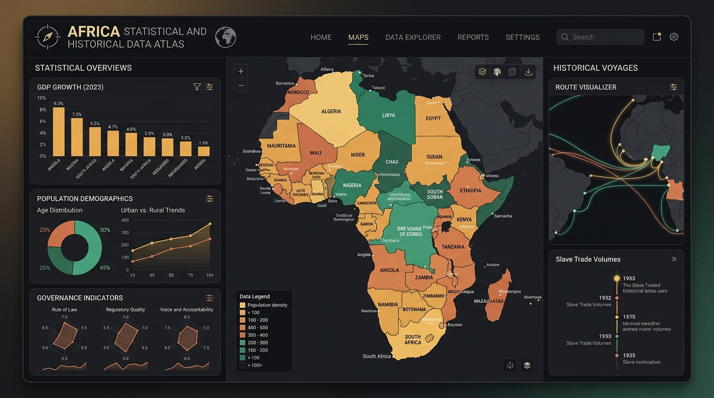

# Africa Digital Atlas

**Africa Digital Atlas** is an open-source, interactive data platform covering all 54 African sovereign nations and territories. It combines a pure-SVG vector cartography engine, 90+ harmonized socioeconomic indicators from 16 multilateral data sources, a 3D historical voyages globe, and comparative analytics tooling into a single offline-capable web app.

**Live app:** [zeluis.github.io/Africa-Digital-Atlas](https://zeluis.github.io/Africa-Digital-Atlas/) **Source code:** [github.com/zeluis/Africa-Digital-Atlas](https://github.com/zeluis/Africa-Digital-Atlas)

## At a glance

* **54** sovereign nations and island states across Northern, Western, Central, Eastern, and Southern Africa
* **8** thematic pillars and **90+** harmonized indicators (2015–2024 curated snapshot with per-value status flags)
* **16** multilateral API connectors (World Bank, IMF, WHO, UNESCO, UN Comtrade, Freedom House, and more)
* **36,108** documented historical voyages (1514–1866; demographic estimates 1501–1866) and **18** curated voyage dossiers in the Transatlantic Slave Voyages 3D globe
* **100%** offline-capable as a Progressive Web App, built with React 19, TypeScript, and Vite

## Where to go next

* [**User Guide**](https://fpizeluis.gitbook.io/fpizeluis-docs/documentation/) — walk through the Atlas's features: the cartography map, country dossiers, analytics, and the historical voyages globe.
* [**Data & Methodology**](https://fpizeluis.gitbook.io/fpizeluis-docs/api-reference/) — the full catalog of data sources, the SVG geography engine, and citation guidance.
* [**Developer Guide**](https://fpizeluis.gitbook.io/fpizeluis-docs/changelog/) — architecture, local setup, and deployment for anyone building on the codebase.
* [**FAQ**](https://fpizeluis.gitbook.io/fpizeluis-docs/help-center/) — answers to common questions about using and citing the Atlas.

## License

Dual-licensed: source code is released under the **MIT License** (`LICENSE-CODE`), and creative assets (all SVG maps, the Ethnic Tree Visualization and SVG, and unless stated otherwise, all graphics and visualizations, authored by **ZéLuis F. Correia**) are released under **CC BY 4.0** (`LICENSE-ASSETS`). Underlying statistical indicators and historical datasets remain subject to the open data licenses and attribution policies of their sponsoring institutions (World Bank, UN, WHO, UNESCO, Freedom House, and the SlaveVoyages research consortium).
